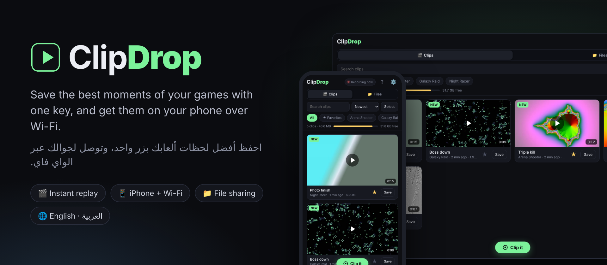
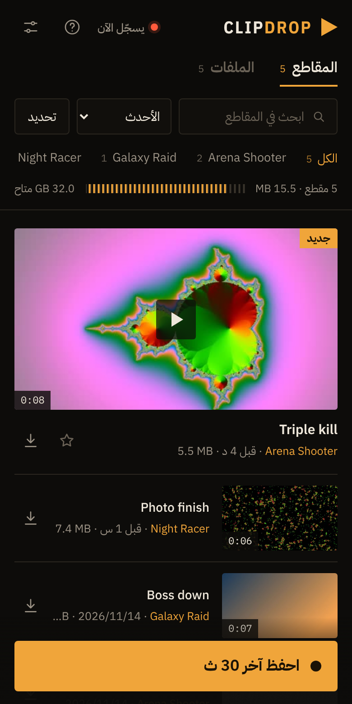
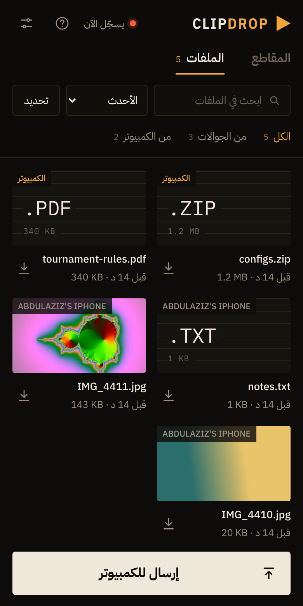
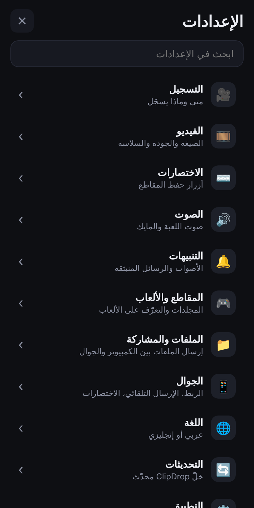
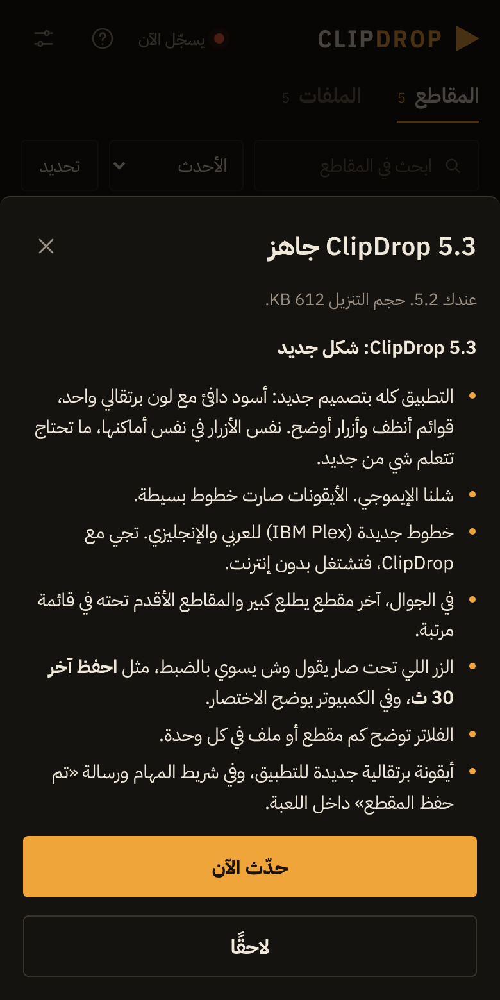

  

  

  
  
  
  

  <a href="README.md">English</a> · <b>العربية</b>

---

**ClipDrop** يحتفظ بآخر لحظات لعبتك بهدوء. صار شيء حلو؟ اضغط **Ctrl + F9** وتنحفظ آخر 30 ثانية. بعدها شاهدها وقصّها وشاركها من الكمبيوتر أو الجوال، عبر الواي فاي حقك.

بدون تطبيق NVIDIA، بدون حساب، بدون سحابة. مقاطعك ما تطلع من بيتك.

## ✨ وش يسوي

| | |
|---|---|
| 🎬 **إعادة فورية** | دائمًا يحتفظ بآخر اللحظات جاهزة، واضغط اختصار عشان تنحفظ. أضف قد ما تبي من الاختصارات، كل واحد بمدة (30 ثانية، دقيقتين، …). |
| 📱 **على جوالك** | افتح ClipDrop في الآيفون أو الأندرويد عبر الواي فاي. شاهد، سمِّ، قص، فضّل واحفظ المقاطع، وتقدر تخليها تنزل في صور الآيفون مباشرة. |
| ✂️ **تعديل سهل** | خلّ جزء أو شيل جزء، اضبط صوتك وصوت اللعبة كل واحد لحاله، أو سوِّ نسخة صغيرة للواتساب. |
| 📁 **مشاركة الملفات** | أرسل صور أو فيديوهات أو أي ملف من الجوال للكمبيوتر أو العكس. كل ملف يوضح مصدره: 📱 **من iPhone** أو 💻 **من الكمبيوتر**. |
| 🎮 **يعرف الألعاب** | المقاطع تتسمى باسم اللعبة وتترتب في مجلدات. سجّل فقط وقت اللعب، ونافذة اللعبة بس إذا تبي. |
| 🎞️ **جودتك** | H.264 أو HEVC أو AV1، لين 4K و 144 إطار، بكرت الشاشة (NVIDIA أو AMD أو Intel). |
| 🌐 **عربي وإنجليزي** | التطبيق كامل، مع الشرح، باللغتين وبواجهة من اليمين لليسار. |
| 🔄 **يحدّث نفسه** | إذا نزلت نسخة جديدة تشوف وش الجديد وتحدّث بضغطة. إعداداتك ومقاطعك تبقى. |

## 📸 صور

<table>
  <tr>
    <td align="center" width="25%"> <b>مقاطعك</b></td>
    <td align="center" width="25%"> <b>مشاركة الملفات بالاتجاهين</b></td>
    <td align="center" width="25%"> <b>الإعدادات</b></td>
    <td align="center" width="25%"> <b>تحديث بضغطة</b></td>
  </tr>
</table>

## 🚀 البداية

1. **حمّل** [ClipDrop-Setup.exe](https://github.com/abokhalid966/clipdrop/raw/main/updates/ClipDrop-Setup.exe) وشغّله.
   إذا طلعت رسالة *"Windows protected your PC"* اضغط **More info** ← **Run anyway**. (برنامج التثبيت مو موقّع بشهادة مدفوعة، وهذا طبيعي للتطبيقات المجانية الصغيرة.)
2. كمّل خطوات التثبيت. ما يحتاج صلاحيات مسؤول، وأول مرة ينزّل نسخته الخاصة من Python و FFmpeg (تقريبًا 150 ميجا).
3. ClipDrop يشتغل كأيقونة خضراء صغيرة جنب الساعة، ويفتح **رمز QR**.
4. **امسحه بكاميرا الجوال** (نفس الواي فاي). في Safari اضغط **مشاركة ← إضافة إلى الشاشة الرئيسية** عشان يفتح مثل التطبيق.
5. إذا سألك ويندوز عن الجدار الناري، اختر **Private networks** واضغط **Allow**.

خلاص. العب، واضغط **Ctrl + F9** إذا صار شيء يستاهل.

## 🎮 طريقة الاستخدام

<b>حفظ المقاطع</b>

- اضغط **Ctrl + F9** في اللعبة عشان تحفظ آخر 30 ثانية. بتسمع رنة قصيرة وتشوف *تم حفظ المقطع* في الزاوية، وما تظهر في المقطع نفسه.
- أو اضغط **احفظ مقطع** من الجوال.
- تبي مدد ثانية؟ الإعدادات ← **الاختصارات** ← *إضافة اختصار*، مثلًا **Ctrl + F10** لآخر دقيقتين.
- المقاطع تنحفظ في `Videos\ClipDrop` داخل مجلد لكل لعبة.
- النقطة فوق توضح الحالة: 🔴 يسجّل · 🟡 ينتظر لعبة · ⚪ متوقف.

<b>المشاهدة والتعديل والمشاركة</b>

اضغط أي مقطع لتشغيله. تحت الفيديو:

| الزر | وش يسوي |
|---|---|
| **إعادة تسمية** | تعطي المقطع اسم تتذكره. |
| **تعديل** | اسحب المقبضين فوق شريط الصور. **إبقاء الجزء المحدد** يخليه، و**قص الجزء المحدد** يشيله. إذا المايك شغّال تضبط صوتك وصوت اللعبة كل واحد لحاله. |
| **حجم للمشاركة** | نسخة صغيرة 720p (تقريبًا 15 ميجا) تنرسل بسرعة على واتساب أو سناب. |
| **حفظ** | ينزّل المقطع بجودته الكاملة للجوال. |
| **★** | يضيفه للمفضلة. |

استخدم **البحث** و**الترتيب** (الأحدث، الأطول، الأكبر، حسب اللعبة…) و**أزرار الألعاب** و**تحديد** لإدارة مقاطع كثيرة مرة وحدة.

<b>إرسال الملفات بين الكمبيوتر والجوال</b>

افتح تبويب **الملفات**.

- **من الجوال للكمبيوتر:** اضغط **إرسال للكمبيوتر** واختر صور أو فيديوهات أو ملفات. توصل في `Downloads\ClipDrop Shared\From (اسم جوالك)` ويطلع تنبيه صغير في الكمبيوتر.
- **من الكمبيوتر للجوال:** اسحب الملفات لنافذة ClipDrop، أو زر أيمن على أي ملف في ويندوز ← **Send to** ← **ClipDrop (send to phone)**. (في ويندوز 11 اضغط *Show more options* أول.)
- كل ملف عليه علامة 📱 **من iPhone** أو 💻 **من الكمبيوتر**، وأزرار الفلترة تعرض جهة وحدة.
- عشان الفيديوهات من الآيفون توصل بجودتها الكاملة، جهّز اختصار **Send to PC** في قائمة المشاركة (الإعدادات ← الجوال).

<b>الإرسال التلقائي لصور الآيفون</b>

باختصار صغير (تقريبًا 3 دقائق، والشرح خطوة بخطوة داخل التطبيق في الإعدادات ← الجوال)، المقاطع الجديدة تنزل في تطبيق الصور لحالها، مثلًا كل مرة تفتح الصور. وكل مقطع ينرسل مرة وحدة بس.

<b>أي صيغة فيديو أختار؟</b>

| الصيغة | اخترها إذا | معلومة |
|---|---|---|
| **H.264** | تشارك كثير أو مو متأكد | تشتغل في كل مكان. ملفاتها الأكبر. |
| **HEVC** | تشاهد غالبًا على الآيفون | نفس الجودة بنص الحجم تقريبًا. |
| **AV1** | عندك كرت شاشة حديث | أصغر الملفات. تحتاج RTX 40 / RX 7000 / Arc للتسجيل و iPhone 15 Pro أو أحدث للتشغيل. |

الإعدادات توضح أي صيغ يقدر جهازك يسجّلها.

<b>الإعدادات</b>

كل شيء تقدر تغيّره، وكل خيار معه شرح قصير. الإعدادات مقسمة إلى **التسجيل، الفيديو، الاختصارات، الصوت، التنبيهات، المقاطع والألعاب، الملفات والمشاركة، الجوال، التحديثات، اللغة، التطبيق**، مع بحث وزر *إرجاع للافتراضي* لكل قسم.

## 🔄 التحديثات

ClipDrop يبحث عن نسخة جديدة لما يشتغل ومرة كل يوم. إذا فيه وحدة جاهزة يطلع شريط أزرق أعلى التطبيق:

1. اضغط **وش الجديد** عشان تقرأ التغييرات (بالعربي أو الإنجليزي).
2. اضغط **حدّث الآن**. ClipDrop يقفل ثواني ويفتح مرة ثانية.

إعداداتك ومقاطعك وملفاتك تبقى دائمًا. وتقدر تبحث بنفسك (الإعدادات ← **التحديثات** ← **ابحث الآن**، أو من قائمة الأيقونة)، أو تخلي التحديثات تتثبت لحالها. كل تنزيل يتأكد من **بصمته (SHA-256)** قبل التثبيت. كل النسخ في [updates/CHANGES.md](updates/CHANGES.md).

## ❓ أسئلة ومشاكل

<b>الجوال ما يتصل</b>

- لازم ClipDrop يكون شغّال (الأيقونة الخضراء جنب الساعة) والجهازين على **نفس الواي فاي**.
- اسمح لـ ClipDrop في جدار ويندوز الناري للشبكات **الخاصة** (ابدأ ← *Allow an app through Windows Firewall* ← فعّل Private لـ `pythonw`).
- إذا انعاد تشغيل الراوتر، زر أيمن على الأيقونة ← **ربط الجوال** وامسح الرمز الجديد.

<b>الاختصار ما يسوي شيء</b>

ممكن برنامج ثاني يستخدم نفس الأزرار، والإعدادات تعرض رسالة حمراء تحت الاختصار إذا كذا. اختر غيره. وإذا مفعّل "فقط وقت اللعب"، المقاطع تنحفظ بس لما تكون فيه لعبة مفتوحة.

<b>المقاطع سوداء أو بدون صوت</b>

- سوداء: خلّ *ماذا يسجّل* على **الشاشة كاملة**، وشغّل اللعبة بدون حدود أو بنافذة.
- بدون صوت: من الإعدادات ← الصوت، اختر السماعة اللي فعلًا تسمع منها.

<b>هل هو آمن؟ هل يطلع شيء للإنترنت؟</b>

مقاطعك وملفاتك تنتقل فقط بين الكمبيوتر والجوال على الواي فاي حقك، وصفحة الجوال محمية برابط خاص (رمز QR). الشيء الوحيد اللي ClipDrop يجيبه من الإنترنت هو البحث عن التحديثات من هذي الصفحة.

<b>كيف أحذفه؟</b>

الإعدادات ← Apps ← Installed apps ← **ClipDrop** ← Uninstall. مقاطعك (`Videos\ClipDrop`) وملفاتك المشتركة (`Downloads\ClipDrop Shared`) تبقى.

وفيه مساعدة أكثر داخل التطبيق: اضغط **?** فوق.

