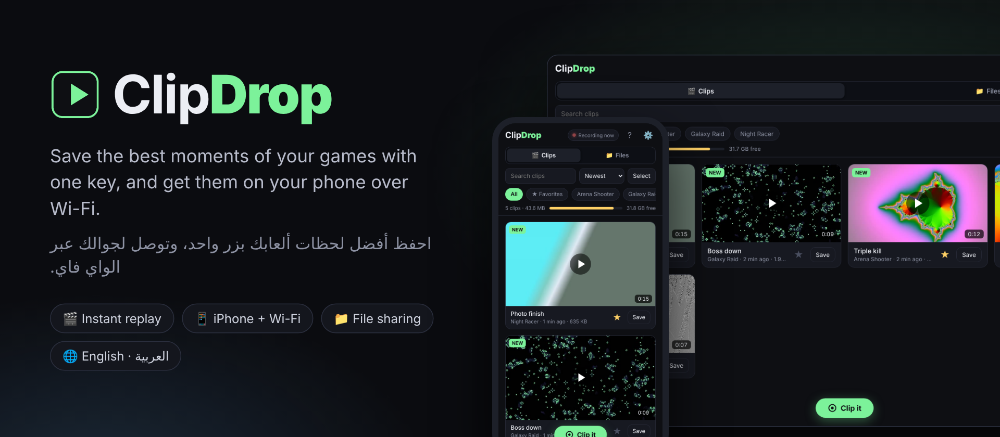
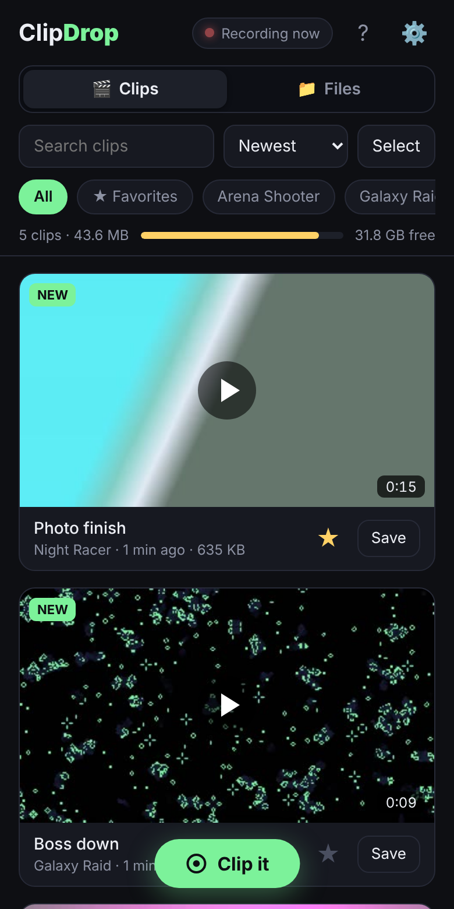
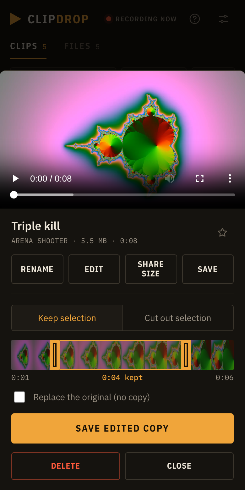
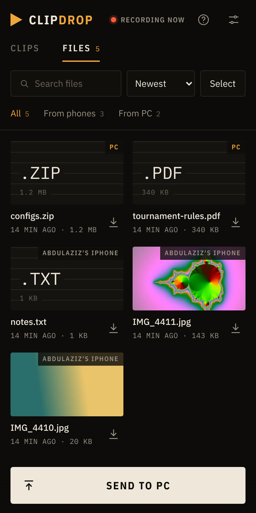
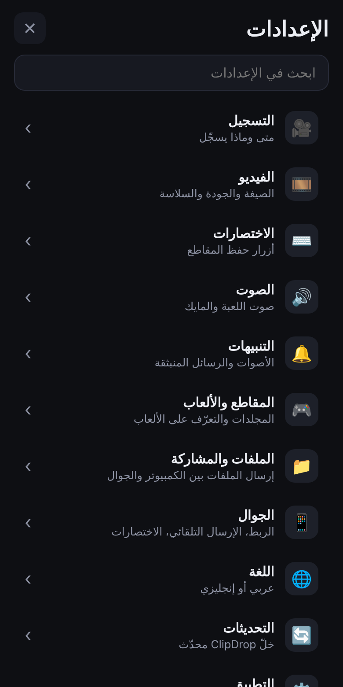
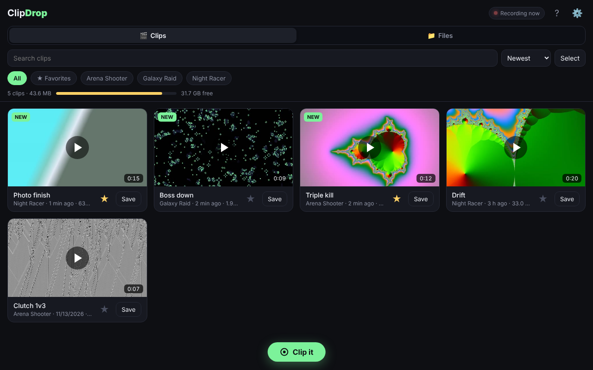
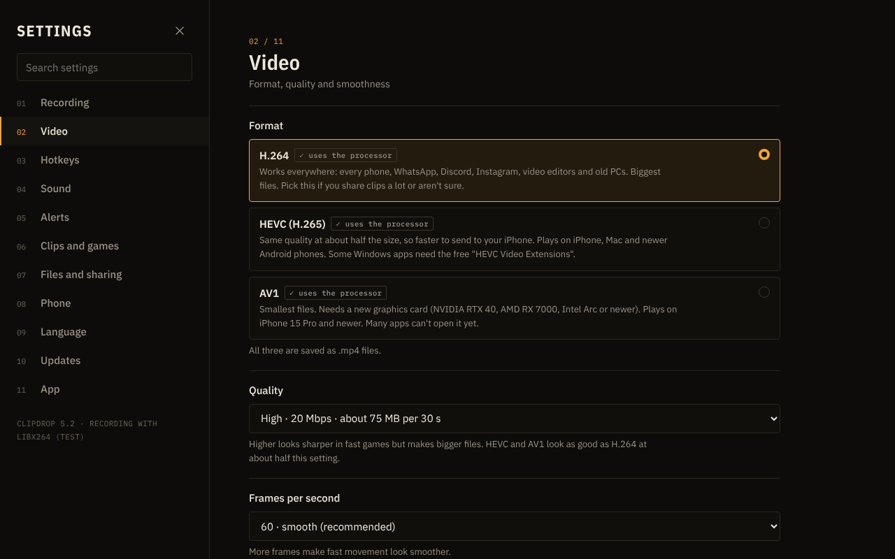

  

  

  
  
  
  
  

  <b>English</b> · <a href="README.ar.md">العربية</a>

---

**ClipDrop** quietly keeps the last moments of your game. Something cool happens? Press **Ctrl + F9** and the last 30 seconds are saved. Then watch, trim and share them on your PC or your phone, over your own Wi-Fi.

No NVIDIA app, no account, no cloud. Your clips never leave your home.

## ✨ What it does

| | |
|---|---|
| 🎬 **Instant replay** | Always keeps the last moments ready. Press a hotkey to save them. Add as many hotkeys as you want, each with its own length (30 seconds, 2 minutes, …). |
| 📱 **On your phone** | Open ClipDrop on your iPhone or Android over Wi-Fi. Watch, rename, trim, favorite and save clips. New clips can even go straight into your iPhone's Photos. |
| ✂️ **Easy editing** | Keep a part or cut a part out, turn your voice and the game sound up or down separately, or make a small copy for WhatsApp. |
| 📁 **File sharing** | Send photos, videos or any file from your phone to the PC, or from the PC to your phone. Every file shows where it came from: 📱 **From iPhone** or 💻 **From PC**. |
| 🎮 **Game aware** | Clips are named after the game and sorted into folders. Record only while you play, and only the game window if you want. |
| 🎞️ **Your quality** | H.264, HEVC or AV1, up to 4K and 144 fps, recorded with your graphics card (NVIDIA, AMD or Intel). |
| 🌐 **English and Arabic** | The whole app, including the guide, in both languages, with a proper right-to-left layout. |
| 🔄 **Updates itself** | When a new version is out you see what's new and update with one tap. Your settings and clips stay. |

## 📸 Screenshots

<table>
  <tr>
    <td align="center" width="25%"> <b>Your clips</b></td>
    <td align="center" width="25%"> <b>Watch and edit</b></td>
    <td align="center" width="25%"> <b>Share files both ways</b></td>
    <td align="center" width="25%"> <b>Settings, in Arabic too</b></td>
  </tr>
</table>

  
  

## 🚀 Get started

1. **Download** [ClipDrop-Setup.exe](https://github.com/abokhalid966/clipdrop/raw/main/updates/ClipDrop-Setup.exe) and run it.
   If Windows says *"Windows protected your PC"*, click **More info** → **Run anyway**. (The setup isn't signed with a paid certificate. That's normal for small free apps.)
2. Click through the setup. It needs no admin rights and downloads its own copy of Python and FFmpeg (about 150 MB) the first time.
3. ClipDrop starts as a small green icon by the clock, and a **QR code** opens.
4. **Scan it with your phone camera** (same Wi-Fi). In Safari tap **Share → Add to Home Screen** so ClipDrop opens like an app.
5. If Windows asks about the firewall, tick **Private networks** and click **Allow**.

That's it. Play, and press **Ctrl + F9** when something good happens.

## 🎮 How to use it

<b>Saving clips</b>

- Press **Ctrl + F9** in a game to save the last 30 seconds. You hear a short ding and see *Clip saved* in the corner. It never shows up in the clip itself.
- Or tap **Clip it** on your phone.
- Want other lengths? Settings → **Hotkeys** → *Add a hotkey*, for example **Ctrl + F10** for the last 2 minutes.
- Clips are saved in `Videos\ClipDrop`, in a folder per game.
- The dot at the top shows the state: 🔴 recording · 🟡 waiting for a game · ⚪ off.

<b>Watching, editing and sharing</b>

Tap a clip to play it. Under the video you'll find:

| Button | What it does |
|---|---|
| **Rename** | Give the clip a name you'll remember. |
| **Edit** | Drag the handles over the picture strip. **Keep selection** keeps that part, **Cut out selection** removes it. With your mic on, set your voice and the game sound separately. |
| **Share size** | A small 720p copy (about 15 MB) that sends fast on WhatsApp or Snapchat. |
| **Save** | Download the full-quality clip to your phone. |
| **★** | Add to Favorites. |

Use **search**, **sort** (newest, longest, biggest, by game…), the **game buttons** and **Select** to manage many clips at once.

<b>Sending files between PC and phone</b>

Open the **Files** tab.

- **Phone → PC:** tap **Send to PC** and pick photos, videos or files. They arrive in `Downloads\ClipDrop Shared\From (your phone)`, and the PC shows a small pop-up.
- **PC → phone:** drag files into the ClipDrop window, or right-click any file in Windows → **Send to** → **ClipDrop (send to phone)**. (On Windows 11, click *Show more options* first.)
- Every file has a badge, 📱 **From iPhone** or 💻 **From PC**, and filter buttons show one side at a time.
- For full-quality videos from iPhone, set up the **Send to PC** share-menu shortcut (Settings → Phone).

<b>Auto-send to iPhone Photos</b>

With a small Shortcut (about 3 minutes to set up, step-by-step guide in the app under Settings → Phone), new clips go straight into your Photos app, for example every time you open Photos. Each clip is sent only once.

<b>Which video format should I pick?</b>

| Format | Pick it when | Good to know |
|---|---|---|
| **H.264** | You share a lot, or aren't sure | Plays everywhere. Biggest files. |
| **HEVC** | You mostly watch on iPhone | Same quality at about half the size. |
| **AV1** | You have a new graphics card | Smallest files. Needs RTX 40 / RX 7000 / Arc to record, iPhone 15 Pro+ to play. |

Settings shows which formats your PC can record.

<b>Settings</b>

Everything can be changed, and every option has a short explanation. Settings are grouped into **Recording, Video, Hotkeys, Sound, Alerts, Clips and games, Files and sharing, Phone, Updates, Language** and **App**, with a search box and a *Reset* button for each section.

## 🔄 Updates

ClipDrop checks for a new version when it starts and once a day. When one is ready, a blue bar appears at the top of the app:

1. Tap **What's new** to read the changes (in English or Arabic).
2. Tap **Update now**. ClipDrop closes for a few seconds and opens again.

Your settings, clips and files always stay. You can also check by hand (Settings → **Updates** → **Check now**, or the tray menu), or let updates install by themselves. Every download is checked against its **SHA-256 fingerprint** before it installs. See all versions in [updates/CHANGES.md](updates/CHANGES.md).

## ❓ Questions and problems

<b>My phone can't connect</b>

- ClipDrop must be running (green icon by the clock) and both devices on the **same Wi-Fi**.
- Allow ClipDrop in the Windows firewall on **Private** networks (Start → *Allow an app through Windows Firewall* → tick Private for `pythonw`).
- If your router restarted, right-click the icon → **Connect phone** and scan the new QR code.

<b>The hotkey does nothing</b>

Another app may use the same keys. Settings shows a red message under the hotkey if so. Pick another one. With "Only while I'm gaming" on, clips are saved only while a game is open.

<b>Clips are black or have no sound</b>

- Black: set *What to record* to **Whole screen**, and run the game borderless or windowed.
- No sound: in Settings → Sound, pick the speakers or headset you actually listen with.

<b>Is it safe? Does anything go online?</b>

Your clips and files only travel between your PC and your phone on your own Wi-Fi. A private link (the QR code) protects the phone page. The only thing ClipDrop fetches from the internet is the update check on this page.

<b>How do I uninstall it?</b>

Settings → Apps → Installed apps → **ClipDrop** → Uninstall. Your clips (`Videos\ClipDrop`) and shared files (`Downloads\ClipDrop Shared`) are kept.

More help is built into the app: tap **?** at the top.

## 🛠️ For developers

How it's built and how to release

- `clipdrop.py`: settings, clip library, shared files, updater, web server (standard library only), tray icon
- `recorder.py`: replay buffer with FFmpeg (ddagrab / gfxcapture, NVENC / AMF / QSV / x264), WASAPI game sound and mic
- `winutil.py`: hotkeys, game detection, monitors, in-game overlay
- `web/`: the app page (`app.html`), translations (`i18n.js`), help and iPhone Shortcut guides
- `setup.nsi`: the Windows setup (NSIS 3). `install.ps1` downloads Python 3.12 and FFmpeg into `runtime\`.

**Releasing a new version**

1. Bump `VERSION` in `clipdrop.py` and `!define VERSION` in `setup.nsi`.
2. Build the setup: `makensis setup.nsi`.
3. Write notes (English, then a line `<!-- ar -->`, then Arabic) and run
   `python tools/publish_update.py ClipDrop-Setup-X.Y.exe notes.md`.
4. Commit and push `updates/` to `main`. Installed copies pick it up within a day.

